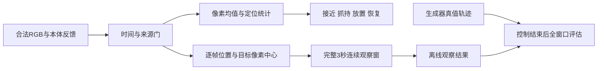

# M1：定位统计与逐帧稳定证据分离

父任务在b947d9e独立确认M1/P1，随后本工作区在0024ef8再次复现：零像素噪声下，释放后的块每0.1秒交替移动±16/20mm，多帧控制及回放仍成功；成功窗口真值跨度分别32/40mm。±20mm的原始视觉重建跨度约39.74mm。旧11/18、3/12扫描确实成立，但没有证明持续运动不会被均值掩盖。

R4/N1和M1是不同问题。0024ef8修复了路径/时间问题的本地反例；**父任务后续确认R4核心P1与N1已独立关闭**；M1及C1/C2残余等待统一独立复验，详见[当前审查状态](replay-residuals.md)。这里不把本地测试写成审查批准。

## 为什么必须分开

均值标准误随样本数下降，反复运动的跨度不会因此下降。两个窗口均值相同不能证明任一窗口内部静止；交替运动的负时间相关也不能靠正相关折算解决。均值/协方差与时间分段诊断继续用于抓点定位、接近/抓持候选和恢复，**不再提供稳定计时或稳定成功的依据**。移除了两个比较均值的stability辅助函数，避免误复用。



## 当前保守稳定门

两种模式都采用同一个简单窗口：

- 每个捕获时刻必须有可重建的RGB位置，间隔≤0.25秒；逐帧满足目标25mm、桌面高度12mm、砌筑区和手分离80mm的实验条件。
- 全窗口任意两帧3D位置距离≤15mm，不只比较均值，也不只比较第一帧。
- **颜色及两路目标像素中心必须保持相同。** 当前没有经验证的逐帧噪声模型，不把中心变化解释为可扣除的噪声；运动/噪声歧义、失视、空窗或位置不合格都会重开计时。没有新增可调“允许抖动”开关。
- 3秒从当前逐帧证据起算。定位窗口的旧样本和增加样本后的较小标准误不能补足它；恢复与重新放置仍受合法路径、动作1.8秒和总试次30秒门约束。

像素中心不变是临时的严格观察条件，可能拒绝实际静止但分割抖动的物体，也可能受有限分辨率/采样率的不可观测变化限制。它不是校准过的真实运动误差界，不能证明接触支撑、物体姿态/转动或采样间的连续物理静止。结果始终保存`physical_stability_verified=false`；这不是官方3秒判分器。

日志manifest为schema5；观测包仍是schema2，接收/原包/捕获时间分离保持。稳定事件声明`stability_basis=raw_rgb_per_frame`，多帧引用只是定位来源注记。独立回放也逐帧检查同样的完整窗口；即使读取旧均值日志，也不能跳过不利原始样本。

## 全窗口真值评估

`scripts/motion_fixtures.py`包装合成生成器，在每个生成时刻记录最终动态更新后的物体位置、本体末端、持有与释放状态。Controller结束后才读取这些记录，另存于忽略目录的`evaluation-trajectory.json`；观测包和控制器没有真值输入，回放也不读取该文件。

成功窗口按原传感器捕获时间选取全部生成时刻，检查首末覆盖、跨帧间隔、≥3秒、全窗口位置直径、每一时刻的目标/高度/砌筑区/手分离、是否仍被持有。最终位置回到目标不抵消中间运动或支撑问题；不再只检查最终误差或特殊LateStep时间。评估只覆盖生成器离散时刻，不宣称已验证真实连续接触物理。

新夹具包含±16/20mm交替、周期1.6秒的±20mm正弦，以及6mm/s单向缓漂。零噪声和1px噪声、两种模式共16例；噪声例可能在放置前就失败，所以单独记录释放后实际运动样本，不把未触发运动的例子当作强运动验证。

为验证评估器本身，用独立只读worktree重新运行0024ef8的八个零噪声运动案例。同一个新评估器准确标出两个交替运动成功为`whole_window_motion`违规，尽管它们的最终目标误差≤25mm、旧回放通过。还用手工真值序列验证“末帧回到目标但中间摆动”、窗口中途仍持有/抬高/手靠近以及缺段不会通过。

## 扫描与完成率回落

| 相同配置/种子 | 0024ef8及旧均值判据 | 当前逐帧保守门 |
|---|---:|---:|
| 匹配单帧 | 6/18 | 6/18 |
| 匹配多帧 | 11/18 | 6/18 |
| 原留出配置（现在是回归） | 3/12 | 0/12 |
| ±16/20mm交替，多帧，零噪声 | 2/2错误成功 | 0/2成功 |

1/2px静止噪声下，多帧模式均无法认证稳定，失败如实保留；不继续平均以换取成功。95例包含原79例配置回归与新增16例运动，不能把混合完成率当比赛胜率。原来源、配置、研究及旧结果文件均保留，新证据另存。当前更有价值的后续工作是实际像素尺度/标定、逐帧误差与相关性、允许输入与停止语义；在它们得到验证前，不建议靠更复杂模型放松稳定门。

```bash
python scripts/noise_validation.py --output runs/new-m1-scan --workers 2
python scripts/check.py
python -m unittest discover -s tests -p test_motion_stability.py -v
# 已检视的旧源码回归，可在独立checkout上复现：
python scripts/motion_baseline.py --checkout /path/to/0024ef8-checkout --output runs/new-baseline-motion
```

[本轮机器证据](evidence/motion-stability-validation.json)锁定源码、夹具、参数、逐例结果及全窗口评估。原始PPM/链式日志/真值轨迹保持本地、可按命令重跑；未上传官方运行数据、模型权重或比赛分享链接。官方平台、真机、训练、付费和远端CI均未运行。

冻结版本本地验证：**70项测试通过，94个相对链接/JSON/来源锁检查通过**。95例共14,526组RGB回放，13个成功窗口逐时刻真值检查无错误接受；16个运动案例均未认证稳定。用当前回放审核旧79例，71例通过、8个旧均值成功因原始帧条件不满足被拒绝，旧日志及结果不改写。源码指纹`6bf5c8e2daaf22c353e4060b5e159c90c799f3ee8cdb91c32e41421fc202b10b`；执行Git基线为0024ef8且dirty=true，参数与脚本按机器证据锁定。cfad964交付时仍等待统一复验；其后已收到R4核心/N1关闭结论，M1与C1/C2状态见上述更新。
