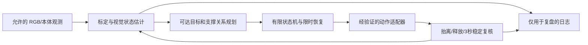

# 技术路线、选组建议与首周实验

依据 [规则摘录](rules-matrix.md)、[原始项目](open-source.md) 和 [论文](papers.md)，以下为工程建议。2026-10-12已推进[合成RGB闭环实验](closed-loop-experiments.md)、恢复/回放和批量诊断；下述官方平台实验仍待执行，不将合成结果当官方验证。

## 当前阶段边界：离线已收束，实测暂搁

固定362e9a8的纯离线前置工程已通过[统一独立验收](offline-acceptance.md)，本轮到此收束，不另行启动离线功能或无证据需求。真实平台登录/实测由用户明确暂搁，不重复申请；下列路线和日期表保留为有条件的历史规划，尚未执行，不代表比赛工程完成。只有用户恢复实际平台阶段时，才验证既有传感器/标定、SDK与物理/多块/官方判分边界。

## 选组：先推荐仿真垒砖，再由条件验证决定

| 路线 | 得分入口 | 主要失败与准备成本 | 推荐条件 |
|---|---|---|---|
| 仿真垒砖 | 每块稳定基础分，逐层加形状/颜色 | RGB 标定、抓持滑落、遮挡、关节插补碰撞、倒塌；无需预先假设力传感 | 默认首选；前提是资格/平台资源成立，并能实测满足已核实的合法搬运/区域/支撑/3秒条件 |
| 真机垒砖 | 同样可分阶段积累 | 额外有现场标定、摩擦变化、手磨损、设备排期和安全流程 | 已有同型号设备、现场支持和稳定抓放数据时再比较；本次禁止真机执行 |
| 仿真装配 | 预置 8 分、散料 9 分，离散奖励高 | 工具抓持/触发、轴线对齐、接触/螺纹/卡死模型、有效旋入的可观测性 | 若正式模板已有可靠旋入原语并可从合法输入验证，可能反超；需实证，演练触碰不够 |
| 真机装配 | 真实接触可用专门控制策略 | 扭矩/轴向力、工具与手适配、双臂约束、掉件及硬件风险最高 | 仅对已有设备、成熟装配经验和传感条件队伍有吸引力 |

不依据组名猜“哪个竞争小”。本仓库尚未掌握设备、算力、经验、资格与队友的充分信息；本任务未代选组。用户学校背景为北京信息科技大学，本次所属队伍/报名状态待确认。当时的首周建议是可撤销的研发主线，平台部分现仍暂搁。父核原件已明确基础分不依赖层级/颜色整体完成度，但每块必须由机器人从供应区合法搬入砌筑区，使用允许支撑、撤手后连续静置3秒且最终有效；抓起未放、仍托住、越界、留供应区、人工违规形成及依赖其稳定的块不计。10块30分仅为满足全部条件的理论基础分。颜色分只授予已有形状分块，不能用错误层级的颜色标签单独加分。[原件E-07–E-09](evidence/official-excerpts.md)。

## 最小闭环架构

图表示计划，不表示已有机器人实现。官方 ground-truth、物体 TF 和实体操控接口没有控制入口。

**视觉与几何**：先在 RGB 中做颜色分割、轮廓/矩形、可见角点，再以合法已知尺寸及相机内参做 PnP 或多视角几何。遮挡严重则换视角/移开手，低置信度时暂不下压。底层可用桌面平面交点；高层必须用相应高度或三维估计，不能照搬桌面单应性。用留出标定点和跨视角重投影检验外参，不能只汇报训练点像素误差。对砖块的旋转对称保留等价姿态，避免选一个错误轴向直接执行。

**精度预算**：20mm/15mm 是判分边界，不是应直接采用的控制误差。作为首轮自定目标，可将总定位+执行+释放误差的 P95 控制在约 10mm 水平、7mm 竖直以内；它们不是规则容差实现，也不是已测精度。分别量化视觉、标定、到位、释放漂移，发现系统偏差先改标定，不能靠增加训练数据掩盖。

**单臂优先**：另一臂停在经验证的避碰姿态。使用适合砖形的固定手型候选，验证指间/掌部接触；即使两手均可动，也先避免共享工作区。只有单臂全流程稳定且五分钟预算不足，才评估非重叠空间的双臂流水线。双臂同时动作要付出额外碰撞/相互遮挡成本。

**状态机**：观察→选择→预抓→闭合→小幅抬离并视觉验证→安全高度搬运→下降→释放→手退出→至少 3 秒稳定复核→更新最终状态。正式全自主期间仅允许在指定区域发开始指令，不能人工选目标、远程操控、隐性干预或在线追加目标；装配违规会取消该次成绩，不能自行降系数保留。研发人工复核与正式动作选择分离。每一步有超时、证据和有限重试；不靠一次 `close` 或 `move_to` 返回跳过后验。

| 可见失败 | 恢复动作候选 | 保分与停止条件 |
|---|---|---|
| 未抓住/假闭合 | 重新定位，调整预抓/手型；最多两次额外重试是初始工程预算 | 不持续盲抓同一目标；预算不足换可达块 |
| 抬升滑落 | 停止旧轨迹、重新观测掉落位置与周围结构 | 不用原始目标位姿盲追落块 |
| 路径不可达/肘姿异常 | 退到已验证位置，换接近方向或目标 | 不反复调用同一失败 IK；没有可靠退路就停 |
| 释放粘连/带动下层 | 确认手退出和块独立稳定后再开始稳定窗口 | 不把“手仍托住”计为完成 |
| 遮挡导致状态未知 | 先退出观察，换合法视角 | 未知状态不填成功，不直接加上层 |
| 局部倒塌 | 重新识别幸存支撑图，优先收回掉落块并保护剩余有效块 | 不执行全局清场；恢复风险高于增益则保留现状 |

末段保留观测/撤手/3 秒静置余量。余量要从实际动作 P95 和相机延迟决定，首轮可以试 15 秒作为工程假设；并非官方额外时间。重试、颜色调整和补顶层都须比较“成功新增分 − 失败毁坏已有分”的期望，不能为最后 1 分撞倒底层。

## 何时值得引入模型

| 方法 | 本赛可能收益 | 进入条件 | 不值得上的情形 |
|---|---|---|---|
| 几何+状态机 | 可解释定位、颜色分配、可见后验、显式恢复 | 有可见特征和可标定场景 | 遮挡/柔顺接触无法用观测与离散动作覆盖时需增强 |
| ACT 局部模仿 | 固定抓持/对中阶段的连续协调 | 合法示教、实际观测和动作适配、可复现失败类别；先小数据验证 | 根因是标定/超时/手无反馈时；没有恢复示教却要长程自主 |
| Diffusion Policy | 多种有效抓姿、连续轨迹的多峰分布 | ACT/几何已形成可比基线，GPU与时延预算明确 | 单一固定抓姿已稳定；扩散开销吃掉反馈预算 |
| VLA（OpenVLA 原版作为代表） | 多物体语义和语言泛化 | 确有语义变化瓶颈，支持动作维度与资源，许可可接受 | 四种颜色、固定任务已能几何识别；双臂/O6迁移和数据成本大 |
| 大规模 RL | 可能优化复杂接触策略 | 可靠且允许的仿真、奖励和预算齐备，另行授权 | 当前规则/传感/算力未知；禁用真值决策，禁止本阶段大训 |

模型替换时只替换已定位的失败阶段；保留上层验证、恢复和超时。论文成功率不能写入本赛结果。基础模型不是失败检测器，不因输出动作流畅就确认成功。

## 历史首周（10 月 12–18 日）有条件计划与门槛

该日期表是前置调研时的有条件建议，不是当前执行日程或用户操作要求。平台相关条目未执行且暂搁；离线准备已验收收束，不购买资源、不发起付费执行。

| 日期 | 实验/工作 | 可审查产物与进出门槛 |
|---|---|---|
| 10/12 | 初始化、本次调研、离线计算 | 文档、源锁、单元测试；明确零平台成绩 |
| 10/13 | 用户参加答疑，核实资格和关键 P0；会后复核正式场景 | 问题→官方答复→规则版本差异；未发布则不填正式参数 |
| 10/14 | 只读检查实际模板、话题、许可输入、算力费用；标定方案 | 版本/输入清单；可用观测与收费未清楚前不执行动作 |
| 10/15 | 获准仿真后，标定留出点与单臂安全路点/肘姿 | 不少于 12 个覆盖工作区与高度的留出点；报告 P50/P95/最大误差，遇碰撞停止推进 |
| 10/16 | 单块闭环抓放与稳定，固定配置重复 30 次，覆盖位置/颜色/朝向 | 至少 27/30 完成全链作为初筛，不是高置信可靠性证明；记录所有失败、时延和来源 |
| 10/17 | 可计分基础放置→底层→两层；注入遮挡/空抓/掉落等允许扰动 | 至少 20 次恢复试验（分类型报告）；观察保分、恢复时长和二次破坏；不假造物体操纵接口来造故障 |
| 10/18 | 5 分钟完整试次至少 10 次，比较基础、形状、颜色与恢复消融 | 报告最高/中位/最低、每次最终状态、阶段成功率；不只展示最佳视频。达标后才提模型小样本试验 |

27/30 只是项目门槛，不能据此宣称单块真实成功率 ≥90%。后续给二项比例 Wilson 区间；多块相关失败另用整场通过率/倒塌率反映。模型对照必须使用相同留出布局、相同时间预算与全部试次；示教数据按场景/采集轮次分割，避免相邻视频帧泄漏到验证集。

暂定角色而非代用户分配：A 规则/模板/提交，B 视觉标定，C 运动与恢复，D 数据评估；2 人队可 A+C、B+D 合并。正式 README 需由真实队员确认姓名、贡献和启动说明。

## 记录指标与模型准入

每次记录：代码/配置/模板版本、合法输入列表、场景与模式、随机种子（若可控）、墙钟和平台时钟、每阶段耗时/是否成功、失败类型、重试次数、可引用视频帧、最终块状态、原始分/系数分、人工干预。评估失败也保留为试次，不删除。

建议模型准入条件：同一可观察瓶颈在冻结基线中持续出现；标定和轨迹故障先排除；能采集该阶段的成功及恢复示教；训练和推理资源获得确认；在独立留出场景上带来稳定增益且无保分退化。否则继续改观测、目标选择和状态机，收益更直接。
